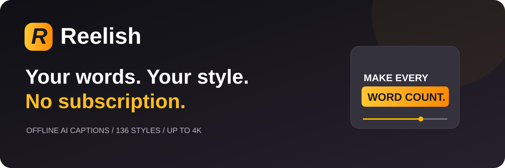
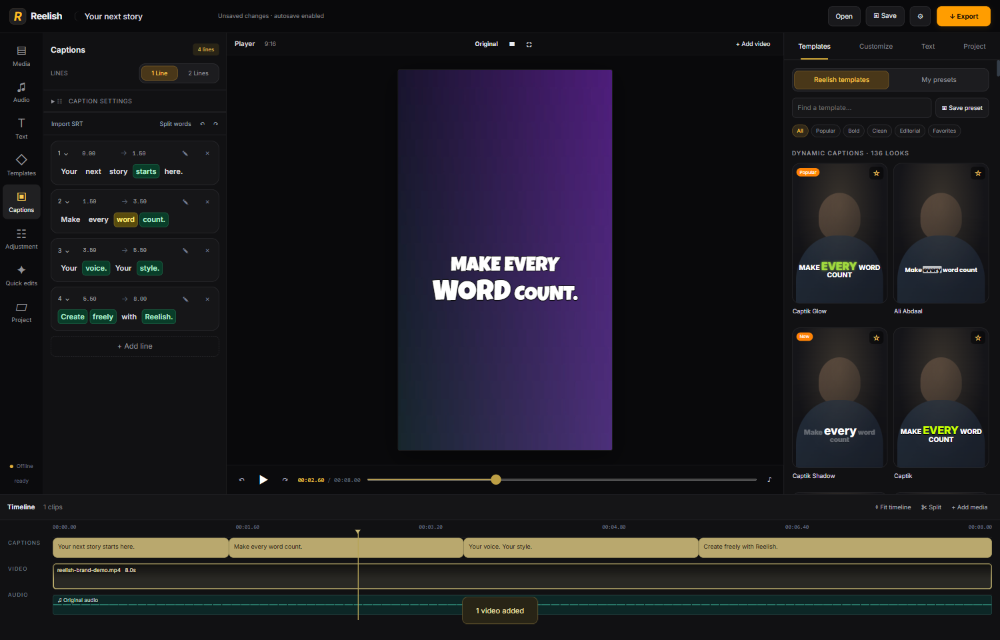

<div align="center">



# Turn your voice into scroll-stopping captions.

**The offline caption and video studio that puts you in control.**

No API keys. No caption-minute credits. No audio uploads. No watermark.

The included caption engine works offline. An optional publisher-hosted **online captions** integration is also available in the source; it is **not activated in the current public download**. The latest source disables paid online speech and uses free models for text tools only; shared provider quotas apply. See the [service activation guide](services/captions/README.md) and [observations from Captik's signed-in editor](docs/CAPTIK-EDITOR-FINDINGS.md).

The latest source includes a caption chooser with **28 languages plus automatic detection**, and **Hinglish in Roman letters** for Hindi-English speech. Example: “Aaj hum video banayenge.” Hinglish conversion works on existing captions through the activated free text service, preserving English words and matching word timing. Native-language captions retain their original script.

**Reelish 1.5 source:** OpenRouter now powers the hosted AI integration for Hinglish conversion of existing captions, opening hooks, translation and reviewed edit plans. Paid speech is disabled by publisher policy; there is no paid fallback. See the [free-only policy](docs/FREE-ONLY.md). The editor adds 36 graphics across 12 families, editable timed layers, layer keyframes, adjustment layers, voiceover recording, word-timeline editing, timing shifts and clip mirror/rotation. Graphics use the same renderer in preview and MP4 export. See the [implementation and verification status](docs/REELISH-1.5-STATUS.md). A publisher-hosted service and OpenRouter credential are still required to activate online AI; the public download has not been replaced by these source changes.

[](https://github.com/iamspyder/Reelish/releases/latest)
[](https://github.com/iamspyder/Reelish/actions/workflows/release.yml)
[](LICENSE)

[Download](#download) · [Features](#make-every-word-yours) · [Get started](#from-raw-take-to-ready-to-post) · [FAQ](#questions-before-your-first-reel) · [Build](#for-builders)

</div>

## Your next reel starts here

You recorded the take. Reelish helps you finish it. Generate captions with the AI included in the app, choose a look, fix any word, shape your edit, and export a clean video. Your media stays on your computer throughout the included offline workflow.

**136 caption presets. 37 font families. Up to 4K export. One install.**



## Download

Every desktop release includes the speech model and video tools: **no Python, API key, or separate model setup**.

| Your computer | Download |
| --- | --- |
| Windows 10/11, 64-bit | [Windows installer](https://github.com/iamspyder/Reelish/releases/latest/download/Reelish-Windows-x64-Setup.exe) |
| macOS, Apple Silicon — M-series | [Apple Silicon DMG](https://github.com/iamspyder/Reelish/releases/latest/download/Reelish-macOS-arm64.dmg) |
| macOS, Intel | [Intel DMG](https://github.com/iamspyder/Reelish/releases/latest/download/Reelish-macOS-x64.dmg) |
| Linux, 64-bit Intel/AMD | [AppImage](https://github.com/iamspyder/Reelish/releases/latest/download/Reelish-Linux-x86_64.AppImage) · [Debian/Ubuntu package](https://github.com/iamspyder/Reelish/releases/latest/download/Reelish-Linux-amd64.deb) |

[All release files, ZIP builds, checksums and release notes →](https://github.com/iamspyder/Reelish/releases/latest)

Files are uploaded after platform checks pass. A missing asset means its build has not been published yet; see [build status](https://github.com/iamspyder/Reelish/actions). Mobile, Windows ARM and Linux ARM packages are not provided.

**Install:** On Windows, run the installer. On macOS, open the DMG and drag Reelish into Applications. On Linux, mark the AppImage executable and run it, or install the `.deb`. These community builds are not publisher-signed or Apple-notarized; your OS may ask you to review the app before opening it. AppImages may need your distribution's FUSE compatibility package; the `.deb` is an alternative on Debian/Ubuntu.

## Make every word yours

### Captions without a running bill

Whisper Base multilingual recognition is included. Generate caption lines and word timings on your computer. No subscription, account, API key or service quota. Work without an internet connection after downloading the installer.

### A look for every story

Explore **136 presets** spanning bold, clean, handwritten, editorial, gradient, glass, spatial and behind-person compositions. Choose from **37 bundled font families** or import your own fonts. Adjust color, size, outline, emphasis, position and animation. Favorite the styles you love and save your signature looks.

### Keep the human in the frame

Included person segmentation lets compatible captions sit behind the speaker. Subject-centered framing helps keep a person in view. Both run locally, without sending footage to a cutout service.

### Shape the story

- Correct individual words, timing and emphasis; find and replace text.
- Split words and regroup caption lines.
- Trim, split and reorder clips on a timeline.
- Detect pauses and choose a tighter edit.
- Add zoom, pan, rotation and opacity keyframes.
- Adjust brightness, contrast and saturation.
- Add an opening title or simple punch-ins.

### Add sound. Export personality.

Mix a background track, import sound effects, or choose from **12 procedural effects** included in Reelish. Adjust placement and volume, then export MP4 with captions, motion and sound rendered in.

Export at **720p, 1080p or 4K** in **9:16, 16:9, 1:1 or 4:5** for Reels, Shorts, YouTube and your feed. Export **SRT, WebVTT or styled ASS** when you need separate subtitles.

### Your work stays yours

Save editable projects on disk. Autosave recovery and undo/redo help you keep moving. Drag the dividers to resize navigation, transcript/tools, styles/settings and the timeline; the preview fits the space left over. Your layout is remembered on this device. Double-click a divider to restore its size, or choose **Reset layout** in the timeline. Keyboard users can focus a divider and use arrow keys (Shift for larger steps). Your source video is preserved, and exports have **no Reelish watermark**.

## From raw take to ready to post

1. **Import your take.** Add one video or assemble several clips.
2. **Generate captions.** The included offline AI creates timed captions. Choose the spoken language in Settings if auto-detection needs help.
3. **Pick your look.** Apply a preset, upload a font, or customize your signature style.
4. **Make it yours.** Fix words, trim pauses, animate the picture and add sound.
5. **Export and post.** Choose the shape and resolution, then save the finished MP4.

Already have subtitles? Import SRT or WebVTT and start styling.

## Questions before your first reel

**Is it actually free?** The included offline tools have no usage fees, service quotas or watermark. Your computer supplies the processing power. Optional advanced cloud transcription can incur provider charges if you choose to configure it.

**Do I need a key or a separate model?** No. The larger download contains the multilingual speech model, video tools and native speech runtime. Normal offline mode is ready after installation.

**Does my video leave my computer?** Not in the included offline workflow. Optional cloud mode uploads audio only when explicitly selected and invoked.

**Hindi and other languages?** The included model supports multilingual recognition. Choose a language or auto-detection. Accuracy varies: review captions before publishing. Roman-script Hinglish, translation and flawless recognition are not guaranteed.

**Why does export take time?** Styled captions, motion and cutouts render frame by frame. Longer videos, higher resolution and complex effects take more processing time. Try a short 720p export while experimenting.

**Can I open old Clipora projects?** Yes: `.clipora` and `.reelish` projects are supported. Keep referenced media at its original location. The renamed app has its own settings directory.

**What are the limits?** Person-mask edges can be imperfect around hair and movement. Compositions are independently implemented, and ASS cannot reproduce every complex browser style. Generative B-roll, automatic translation, editor plugins and mobile apps are not included.

## For builders

Requires Node.js 22+, Git and platform build tools. Windows speech preparation uses Visual Studio's release redistributable files. macOS/Linux use CMake and a C++ compiler to build pinned Whisper source.

```bash
npm ci
npm run prepare:speech
npm test
npm start
```

Package on the target OS:

```bash
npm run dist          # Windows x64 installer
npm run dist:mac      # macOS DMG + ZIP, native architecture
npm run dist:linux    # Linux x64 AppImage + DEB
```

The [release workflow](.github/workflows/release.yml) builds native Windows, Apple Silicon, Intel Mac and Linux packages, checks the packaged app's speech recognition and MP4 export, and uploads successful artifacts with SHA-256 checksums. Model and engine revisions are pinned in [prepare-speech.cjs](scripts/prepare-speech.cjs).

App source is MIT licensed. Bundled dependencies, model assets and fonts retain their own licenses: see [third-party notices](THIRD-PARTY-NOTICES.md).

## Help shape Reelish

[Report a bug or suggest a feature](https://github.com/iamspyder/Reelish/issues/new). Include your OS, app version and reproduction steps; avoid posting private videos or credentials. If Reelish helps your workflow, a GitHub star helps others discover it.

<div align="center"><strong>Your words. Your style. Your computer.</strong><br>Made for creators who want to keep creating.</div>
